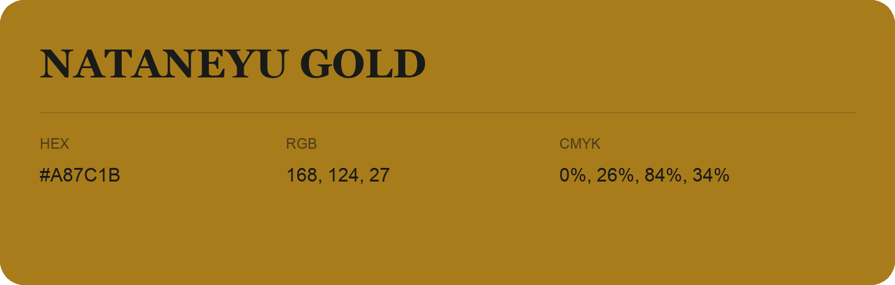

## Nataneyu Gold

- HEX: #A87C1B
- RGB: 168, 124, 27
- CMYK: 0%, 26%, 84%, 34%
- Character: earthy, rich, warm
- Suggested uses: artisan businesses, hospitality brands, warm accents

- Source images: IMG_9053.JPG
