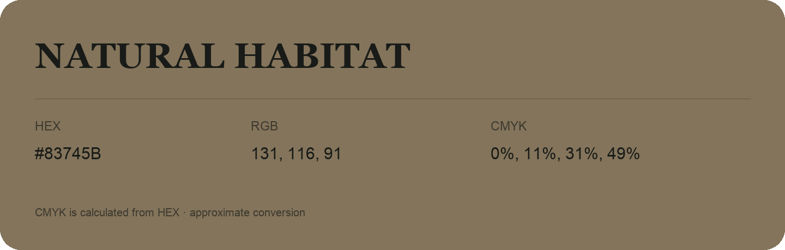

## Natural Habitat

- HEX: #83745B
- RGB: 131, 116, 91
- CMYK: 0%, 11%, 31%, 49%
- Character: earthy, rich, warm
- Suggested uses: premium packaging, rustic brands, dark backgrounds

- Source images: IMG_9017.JPG

- Data provenance: CMYK calculated from HEX using the page’s conversion; source image CMYK was unreadable. This is an approximate conversion without a print color profile.
