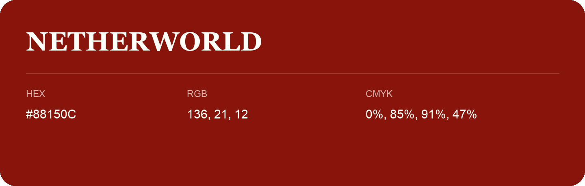

## Netherworld

- HEX: #88150C
- RGB: 136, 21, 12
- CMYK: 0%, 85%, 91%, 47%
- Character: warm, expressive, energetic
- Suggested uses: food brands, expressive identities, promotional accents

- Source images: iCloud Photos 2/IMG_9157.JPG
