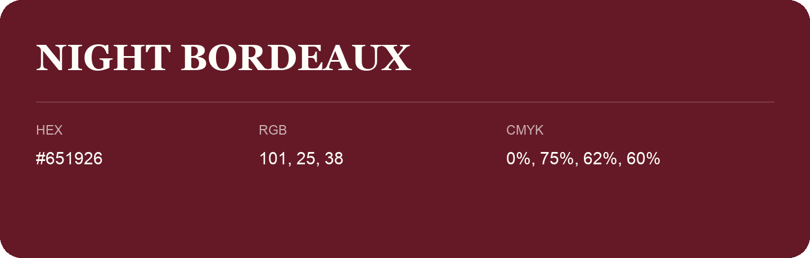

## Night Bordeaux

- HEX: #651926
- RGB: 101, 25, 38
- CMYK: 0%, 75%, 62%, 60%
- Character: warm, expressive, energetic
- Suggested uses: food brands, expressive identities, promotional accents

- Source images: IMG_8992.JPG
