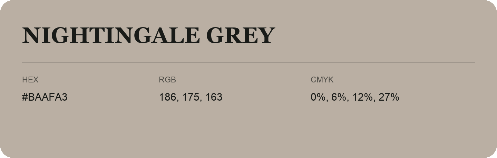

## Nightingale Grey

- HEX: #BAAFA3
- RGB: 186, 175, 163
- CMYK: 0%, 6%, 12%, 27%
- Character: quiet, balanced, understated
- Suggested uses: professional services, minimal identities, supporting backgrounds

- Source images: IMG_9017.JPG
