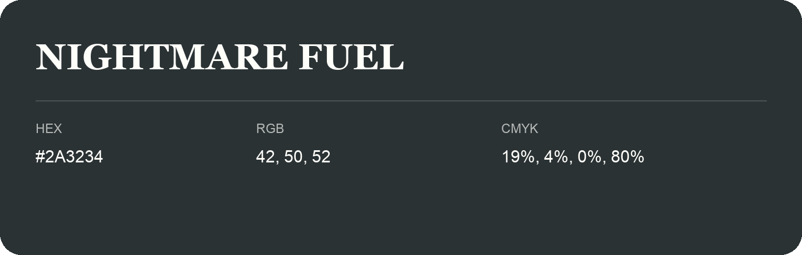

## Nightmare Fuel

- HEX: #2A3234
- RGB: 42, 50, 52
- CMYK: 19%, 4%, 0%, 80%
- Character: deep, grounded, understated
- Suggested uses: premium packaging, editorial typography, dark backgrounds

- Source images: iCloud Photos 2/IMG_9126.JPG
