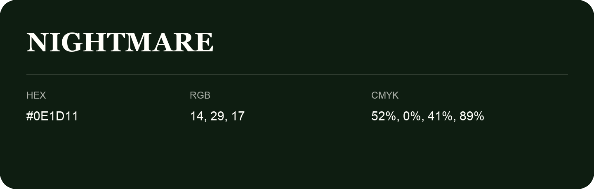

## Nightmare

- HEX: #0E1D11
- RGB: 14, 29, 17
- CMYK: 52%, 0%, 41%, 89%
- Character: natural, grounded, fresh
- Suggested uses: outdoor businesses, wellness brands, organic packaging

- Source images: IMG_8994.JPG

- Data provenance: HEX recovered from page data; cross-checked against the readable source RGB.
