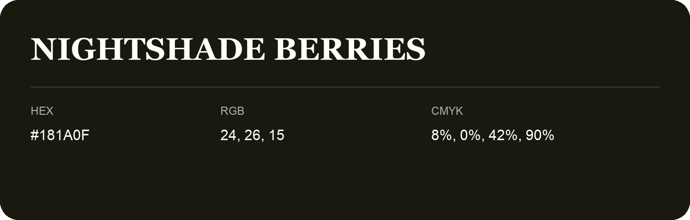

## Nightshade Berries

- HEX: #181A0F
- RGB: 24, 26, 15
- CMYK: 8%, 0%, 42%, 90%
- Character: natural, grounded, fresh
- Suggested uses: outdoor businesses, wellness brands, organic packaging

- Source images: IMG_8980.JPG

- Data provenance: HEX recovered from page data; cross-checked against the readable source RGB.

- Name note: Other distinct shades share this name: [nightshade-berries-1c1814](nightshade-berries-1c1814.md), [nightshade-berries-1c1914](nightshade-berries-1c1914.md).
