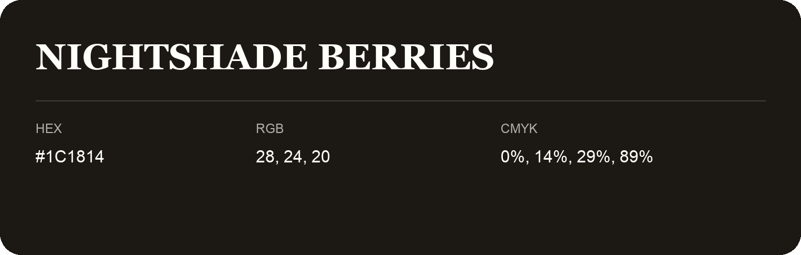

## Nightshade Berries

- HEX: #1C1814
- RGB: 28, 24, 20
- CMYK: 0%, 14%, 29%, 89%
- Character: deep, grounded, understated
- Suggested uses: premium packaging, editorial typography, dark backgrounds

- Source images: IMG_9113.JPG

- Name note: Other distinct shades share this name: [nightshade-berries-181a0f](nightshade-berries-181a0f.md), [nightshade-berries-1c1914](nightshade-berries-1c1914.md).
