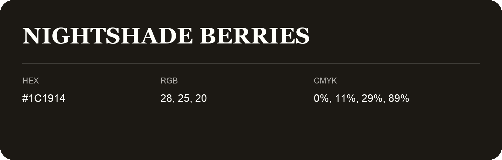

## Nightshade Berries

- HEX: #1C1914
- RGB: 28, 25, 20
- CMYK: 0%, 11%, 29%, 89%
- Character: deep, grounded, understated
- Suggested uses: premium packaging, editorial typography, dark backgrounds

- Source images: iCloud Photos 2/IMG_9177.JPG

- Name note: Other distinct shades share this name: [nightshade-berries-181a0f](nightshade-berries-181a0f.md), [nightshade-berries-1c1814](nightshade-berries-1c1814.md).
