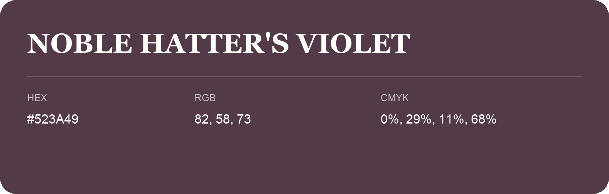

## Noble Hatter'S Violet

- HEX: #523A49
- RGB: 82, 58, 73
- CMYK: 0%, 29%, 11%, 68%
- Character: expressive, imaginative, refined
- Suggested uses: beauty brands, creative businesses, distinctive accents

- Source images: IMG_9102.JPG
