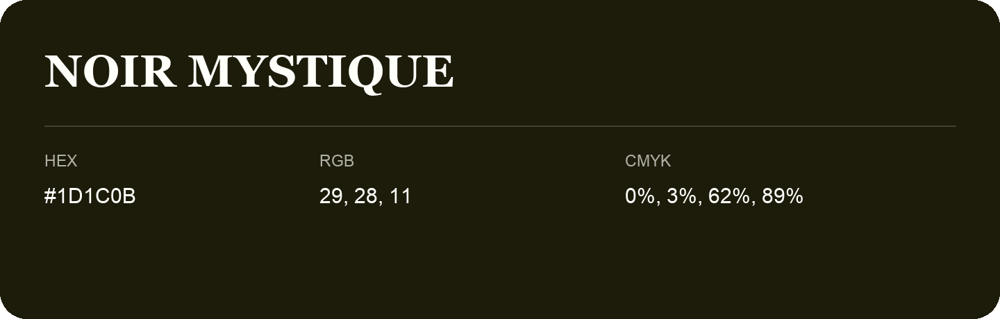

## Noir Mystique

- HEX: #1D1C0B
- RGB: 29, 28, 11
- CMYK: 0%, 3%, 62%, 89%
- Character: deep, grounded, understated
- Suggested uses: premium packaging, editorial typography, dark backgrounds

- Source images: iCloud Photos 2/IMG_9178.JPG

- Name note: Other distinct shades share this name: [noir-mystique-1f1a0a](noir-mystique-1f1a0a.md), [noir-mystique](noir-mystique.md).
