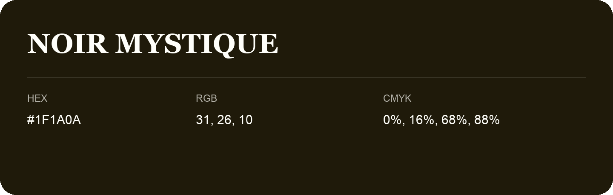

## Noir Mystique

- HEX: #1F1A0A
- RGB: 31, 26, 10
- CMYK: 0%, 16%, 68%, 88%
- Character: deep, grounded, understated
- Suggested uses: premium packaging, editorial typography, dark backgrounds

- Source images: iCloud Photos 2/IMG_9138.JPG

- Name note: Other distinct shades share this name: [noir-mystique-1d1c0b](noir-mystique-1d1c0b.md), [noir-mystique](noir-mystique.md).
