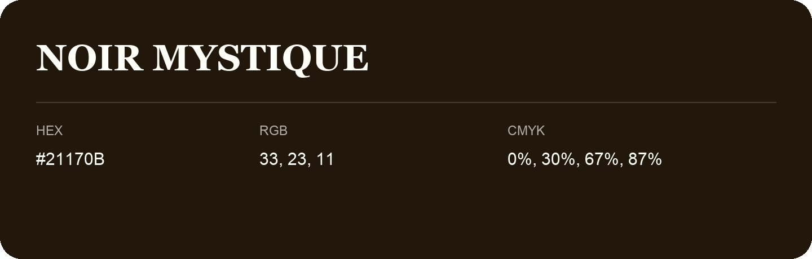

## Noir Mystique

- HEX: #21170B
- RGB: 33, 23, 11
- CMYK: 0%, 30%, 67%, 87%
- Character: earthy, rich, warm
- Suggested uses: premium packaging, rustic brands, dark backgrounds

- Source images: IMG_8977.JPG

- Name note: Other distinct shades share this name: [noir-mystique-1d1c0b](noir-mystique-1d1c0b.md), [noir-mystique-1f1a0a](noir-mystique-1f1a0a.md).
