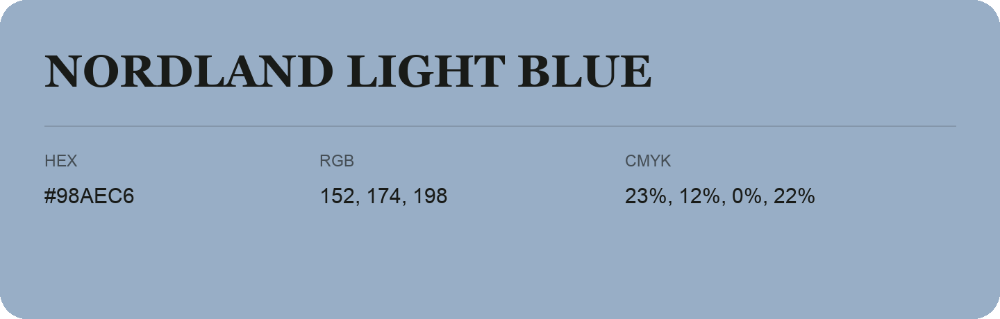

## Nordland Light Blue

- HEX: #98AEC6
- RGB: 152, 174, 198
- CMYK: 23%, 12%, 0%, 22%
- Character: soft, gentle, approachable
- Suggested uses: friendly consumer brands, gentle backgrounds, welcoming accents

- Source images: IMG_9028.JPG

- Data provenance: RGB calculated from HEX, matching the page; source image RGB was unreadable.
