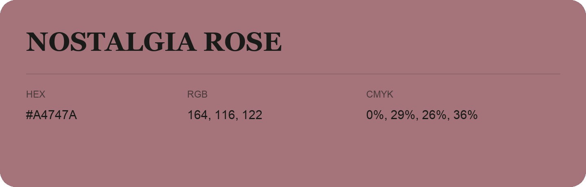

## Nostalgia Rose

- HEX: #A4747A
- RGB: 164, 116, 122
- CMYK: 0%, 29%, 26%, 36%
- Character: warm, expressive, energetic
- Suggested uses: food brands, expressive identities, promotional accents

- Source images: iCloud Photos 2/IMG_9174.JPG
- Data provenance: RGB calculated from HEX; source text recognition was uncertain.
