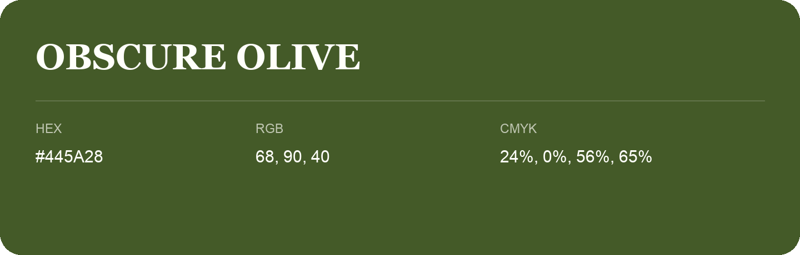

## Obscure Olive

- HEX: #445A28
- RGB: 68, 90, 40
- CMYK: 24%, 0%, 56%, 65%
- Character: natural, grounded, fresh
- Suggested uses: outdoor businesses, wellness brands, organic packaging

- Source images: IMG_9038.JPG
