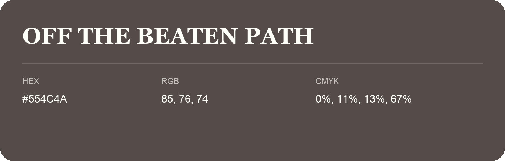

## Off The Beaten Path

- HEX: #554C4A
- RGB: 85, 76, 74
- CMYK: 0%, 11%, 13%, 67%
- Character: restrained, grounded, sophisticated
- Suggested uses: premium brands, editorial typography, dark backgrounds

- Source images: IMG_8977.JPG
