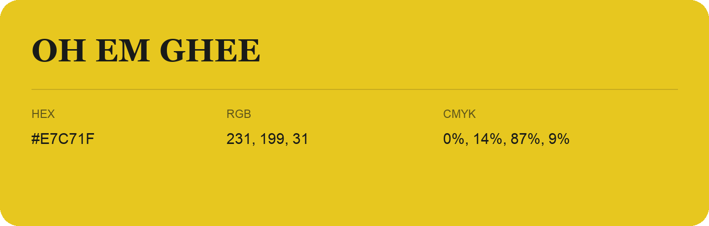

## Oh Em Ghee

- HEX: #E7C71F
- RGB: 231, 199, 31
- CMYK: 0%, 14%, 87%, 9%
- Character: sunny, lively, optimistic
- Suggested uses: friendly consumer brands, food packaging, cheerful accents

- Source images: IMG_8980.JPG
