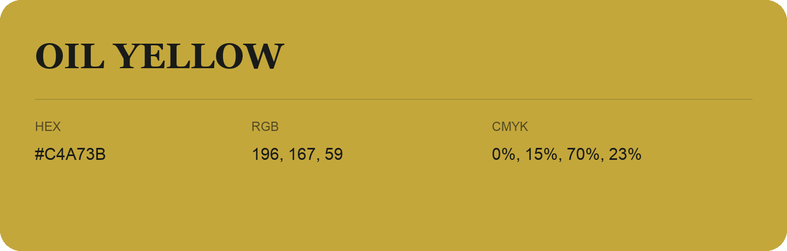

## Oil Yellow

- HEX: #C4A73B
- RGB: 196, 167, 59
- CMYK: 0%, 15%, 70%, 23%
- Character: sunny, lively, optimistic
- Suggested uses: friendly consumer brands, food packaging, cheerful accents

- Source images: IMG_9095.JPG
