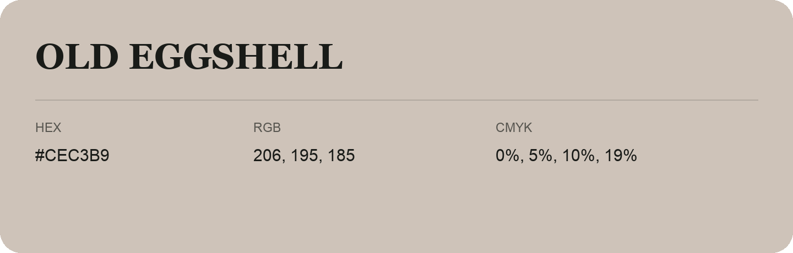

## Old Eggshell

- HEX: #CEC3B9
- RGB: 206, 195, 185
- CMYK: 0%, 5%, 10%, 19%
- Character: quiet, balanced, understated
- Suggested uses: professional services, minimal identities, supporting backgrounds

- Source images: IMG_9081.JPG
