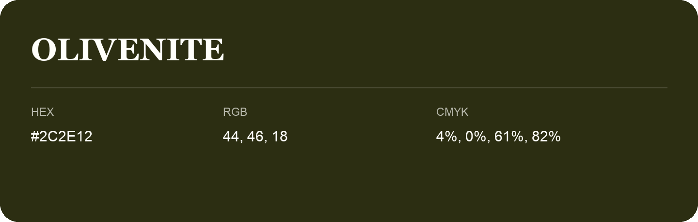

## Olivenite

- HEX: #2C2E12
- RGB: 44, 46, 18
- CMYK: 4%, 0%, 61%, 82%
- Character: deep, grounded, understated
- Suggested uses: premium packaging, editorial typography, dark backgrounds

- Source images: iCloud Photos 2/IMG_9147.JPG
