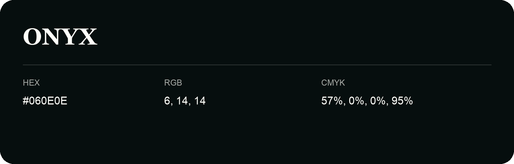

## Onyx

- HEX: #060E0E
- RGB: 6, 14, 14
- CMYK: 57%, 0%, 0%, 95%
- Character: calm, fresh, composed
- Suggested uses: wellness brands, coastal hospitality, modern service brands

- Source images: IMG_8982.JPG

- Data provenance: HEX recovered from page data; cross-checked against the readable source RGB.

- Name note: Other distinct shades share this name: [onyx-0d1616](onyx-0d1616.md).
