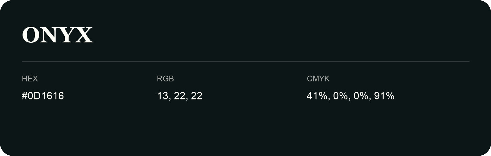

## Onyx

- HEX: #0D1616
- RGB: 13, 22, 22
- CMYK: 41%, 0%, 0%, 91%
- Character: deep, grounded, understated
- Suggested uses: premium packaging, editorial typography, dark backgrounds

- Source images: IMG_8983.JPG

- Name note: Other distinct shades share this name: [onyx-060e0e](onyx-060e0e.md).
