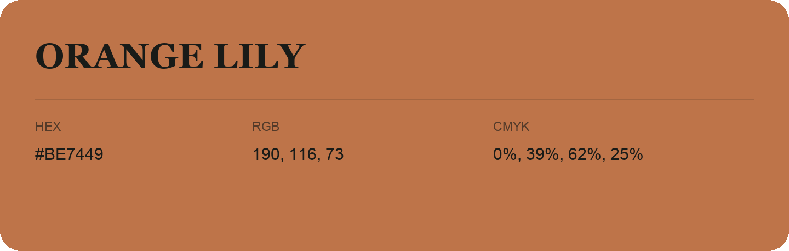

## Orange Lily

- HEX: #BE7449
- RGB: 190, 116, 73
- CMYK: 0%, 39%, 62%, 25%
- Character: earthy, rich, warm
- Suggested uses: artisan businesses, hospitality brands, warm accents

- Source images: IMG_9068.JPG
