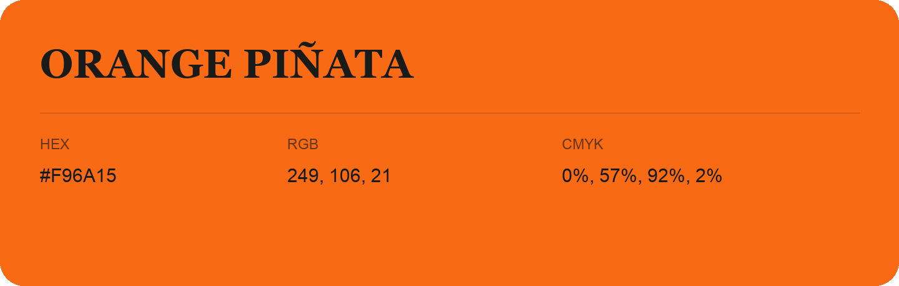

## Orange Piñata

- HEX: #F96A15
- RGB: 249, 106, 21
- CMYK: 0%, 57%, 92%, 2%
- Character: earthy, rich, warm
- Suggested uses: artisan businesses, hospitality brands, warm accents

- Source images: IMG_9064.JPG
