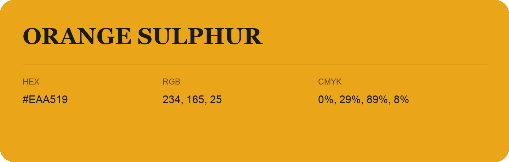

## Orange Sulphur

- HEX: #EAA519
- RGB: 234, 165, 25
- CMYK: 0%, 29%, 89%, 8%
- Character: earthy, rich, warm
- Suggested uses: artisan businesses, hospitality brands, warm accents

- Source images: IMG_9074.JPG
