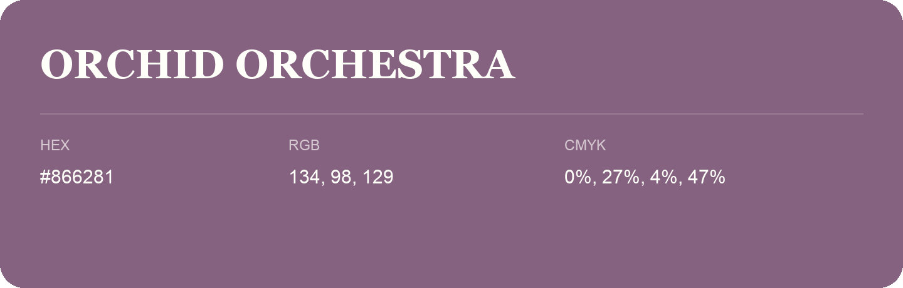

## Orchid Orchestra

- HEX: #866281
- RGB: 134, 98, 129
- CMYK: 0%, 27%, 4%, 47%
- Character: expressive, imaginative, refined
- Suggested uses: beauty brands, creative businesses, distinctive accents

- Source images: IMG_9012.JPG

- Data provenance: RGB calculated from HEX, matching the page; source image RGB was unreadable.
