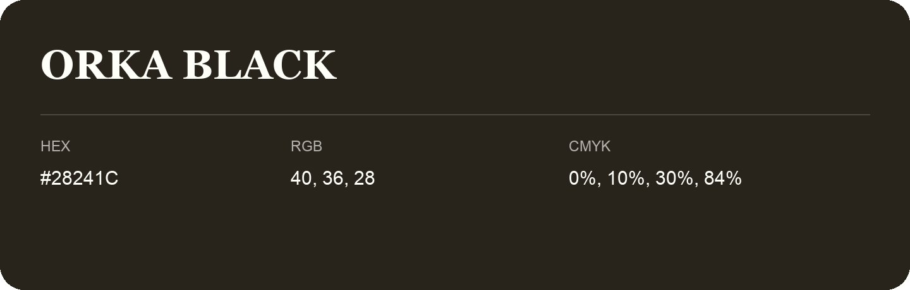

## Orka Black

- HEX: #28241C
- RGB: 40, 36, 28
- CMYK: 0%, 10%, 30%, 84%
- Character: deep, grounded, understated
- Suggested uses: premium packaging, editorial typography, dark backgrounds

- Source images: iCloud Photos 2/IMG_9132.JPG

- Name note: Other distinct shades share this name: [orka-black](orka-black.md).
