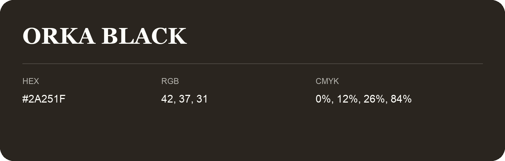

## Orka Black

- HEX: #2A251F
- RGB: 42, 37, 31
- CMYK: 0%, 12%, 26%, 84%
- Character: earthy, rich, warm
- Suggested uses: premium packaging, rustic brands, dark backgrounds

- Source images: IMG_9022.JPG

- Name note: Other distinct shades share this name: [orka-black-28241c](orka-black-28241c.md).
