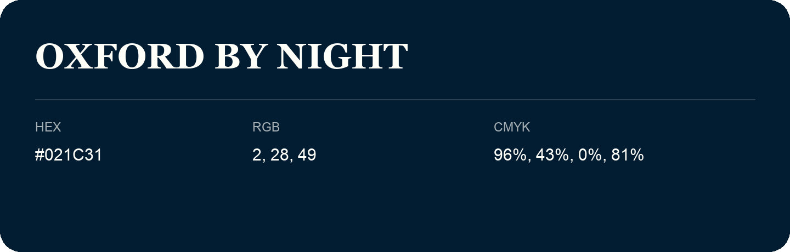

## Oxford By Night

- HEX: #021C31
- RGB: 2, 28, 49
- CMYK: 96%, 43%, 0%, 81%
- Character: deep, grounded, understated
- Suggested uses: premium packaging, editorial typography, dark backgrounds

- Source images: IMG_9015.JPG

- Name note: Other distinct shades share this name: [oxford-by-night-021f2e](oxford-by-night-021f2e.md), [oxford-by-night-031830](oxford-by-night-031830.md), [oxford-by-night-081d2b](oxford-by-night-081d2b.md).
