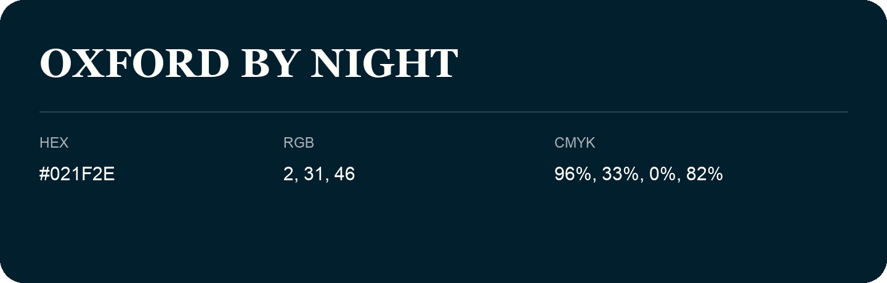

## Oxford By Night

- HEX: #021F2E
- RGB: 2, 31, 46
- CMYK: 96%, 33%, 0%, 82%
- Character: deep, grounded, understated
- Suggested uses: premium packaging, editorial typography, dark backgrounds

- Source images: IMG_9002.JPG

- Name note: Other distinct shades share this name: [oxford-by-night-021c31](oxford-by-night-021c31.md), [oxford-by-night-031830](oxford-by-night-031830.md), [oxford-by-night-081d2b](oxford-by-night-081d2b.md).
