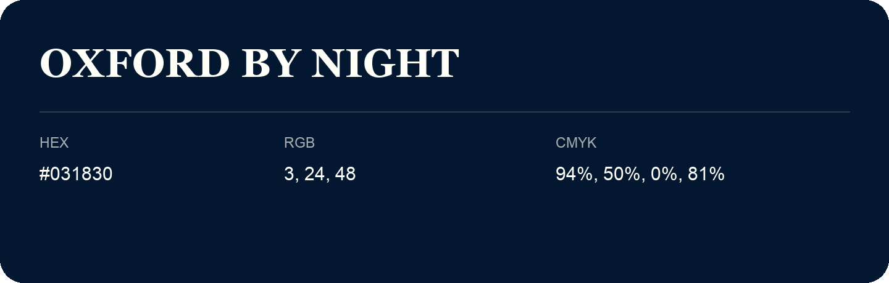

## Oxford By Night

- HEX: #031830
- RGB: 3, 24, 48
- CMYK: 94%, 50%, 0%, 81%
- Character: deep, grounded, understated
- Suggested uses: premium packaging, editorial typography, dark backgrounds

- Source images: iCloud Photos 2/IMG_9163.JPG

- Name note: Other distinct shades share this name: [oxford-by-night-021c31](oxford-by-night-021c31.md), [oxford-by-night-021f2e](oxford-by-night-021f2e.md), [oxford-by-night-081d2b](oxford-by-night-081d2b.md).
