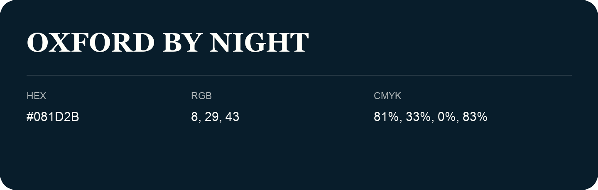

## Oxford By Night

- HEX: #081D2B
- RGB: 8, 29, 43
- CMYK: 81%, 33%, 0%, 83%
- Character: deep, grounded, understated
- Suggested uses: premium packaging, editorial typography, dark backgrounds

- Source images: iCloud Photos 2/IMG_9145.JPG

- Name note: Other distinct shades share this name: [oxford-by-night-021c31](oxford-by-night-021c31.md), [oxford-by-night-021f2e](oxford-by-night-021f2e.md), [oxford-by-night-031830](oxford-by-night-031830.md).
