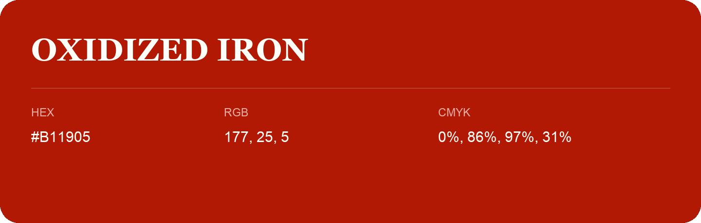

## Oxidized Iron

- HEX: #B11905
- RGB: 177, 25, 5
- CMYK: 0%, 86%, 97%, 31%
- Character: warm, expressive, energetic
- Suggested uses: food brands, expressive identities, promotional accents

- Source images: IMG_8988.JPG
