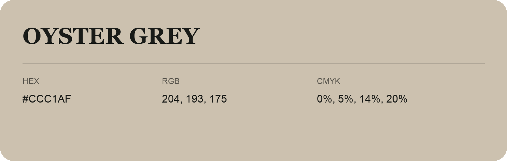

## Oyster Grey

- HEX: #CCC1AF
- RGB: 204, 193, 175
- CMYK: 0%, 5%, 14%, 20%
- Character: soft, gentle, approachable
- Suggested uses: friendly consumer brands, gentle backgrounds, welcoming accents

- Source images: IMG_9051.JPG
