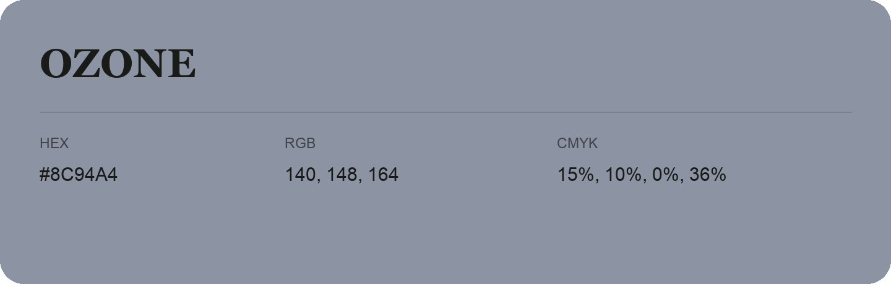

## Ozone

- HEX: #8C94A4
- RGB: 140, 148, 164
- CMYK: 15%, 10%, 0%, 36%
- Character: cool, composed, dependable
- Suggested uses: professional services, technology brands, calm backgrounds

- Source images: IMG_9085.JPG
