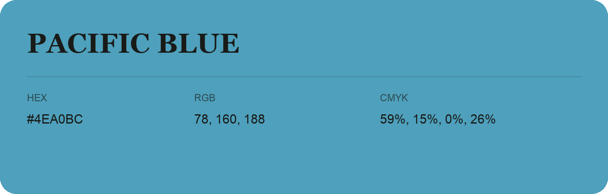

## Pacific Blue

- HEX: #4EA0BC
- RGB: 78, 160, 188
- CMYK: 59%, 15%, 0%, 26%
- Character: calm, fresh, composed
- Suggested uses: wellness brands, coastal hospitality, modern service brands

- Source images: IMG_8982.JPG

- Data provenance: HEX recovered from page data; cross-checked against the readable source RGB.

- Name note: Other distinct shades share this name: [pacific-blue-6bb3c0](pacific-blue-6bb3c0.md).
