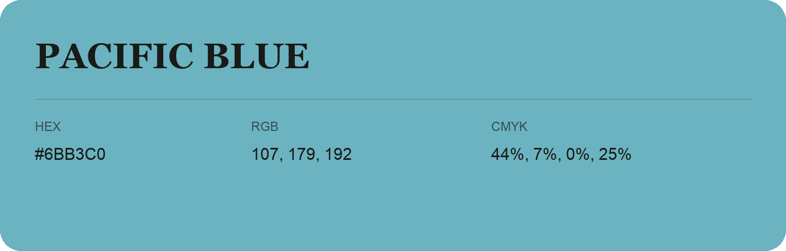

## Pacific Blue

- HEX: #6BB3C0
- RGB: 107, 179, 192
- CMYK: 44%, 7%, 0%, 25%
- Character: calm, fresh, composed
- Suggested uses: wellness brands, coastal hospitality, modern service brands

- Source images: IMG_8993.JPG

- Data provenance: HEX recovered from page data; cross-checked against the readable source RGB.

- Name note: Other distinct shades share this name: [pacific-blue-4ea0bc](pacific-blue-4ea0bc.md).
