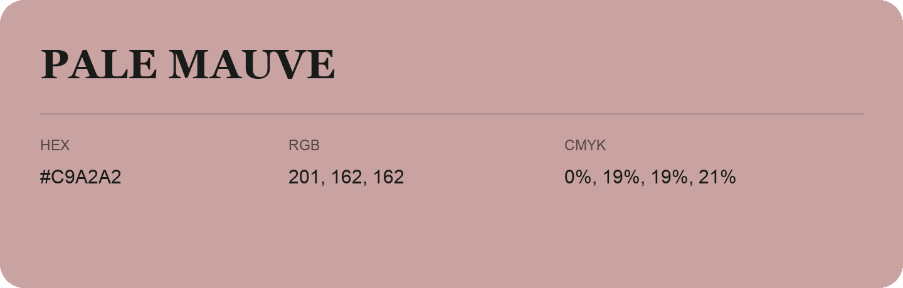

## Pale Mauve

- HEX: #C9A2A2
- RGB: 201, 162, 162
- CMYK: 0%, 19%, 19%, 21%
- Character: soft, warm, playful
- Suggested uses: friendly consumer brands, gentle backgrounds, welcoming accents

- Source images: iCloud Photos 2/IMG_9140.JPG
