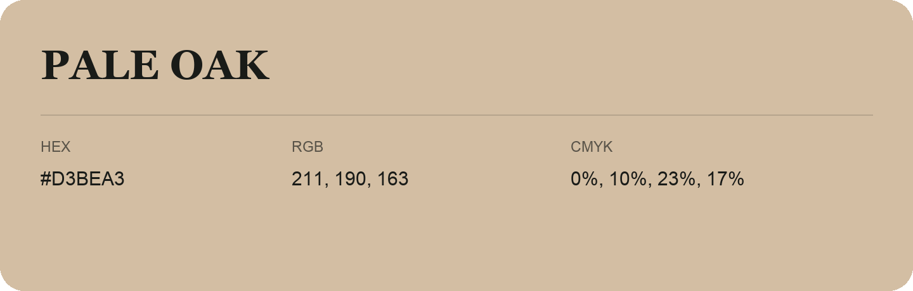

## Pale Oak

- HEX: #D3BEA3
- RGB: 211, 190, 163
- CMYK: 0%, 10%, 23%, 17%
- Character: soft, gentle, approachable
- Suggested uses: friendly consumer brands, gentle backgrounds, welcoming accents

- Source images: IMG_8993.JPG
