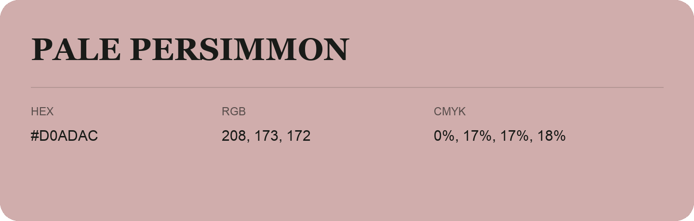

## Pale Persimmon

- HEX: #D0ADAC
- RGB: 208, 173, 172
- CMYK: 0%, 17%, 17%, 18%
- Character: soft, warm, playful
- Suggested uses: friendly consumer brands, gentle backgrounds, welcoming accents

- Source images: iCloud Photos 2/IMG_9174.JPG
