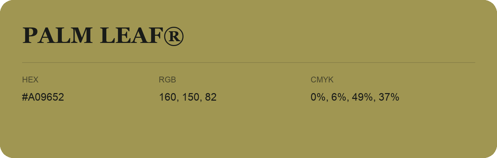

## Palm Leaf®

- HEX: #A09652
- RGB: 160, 150, 82
- CMYK: 0%, 6%, 49%, 37%
- Character: sunny, lively, optimistic
- Suggested uses: friendly consumer brands, food packaging, cheerful accents

- Source images: IMG_8984.JPG
