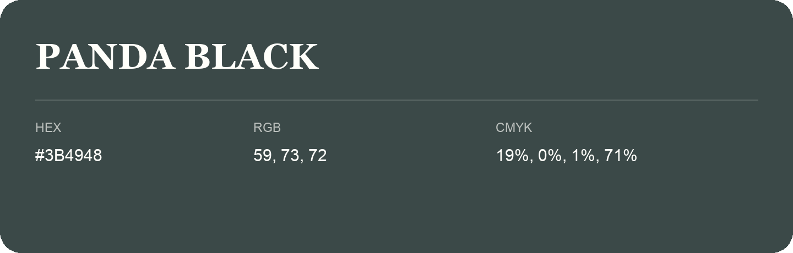

## Panda Black

- HEX: #3B4948
- RGB: 59, 73, 72
- CMYK: 19%, 0%, 1%, 71%
- Character: calm, fresh, composed
- Suggested uses: wellness brands, coastal hospitality, modern service brands

- Source images: IMG_9091.JPG
