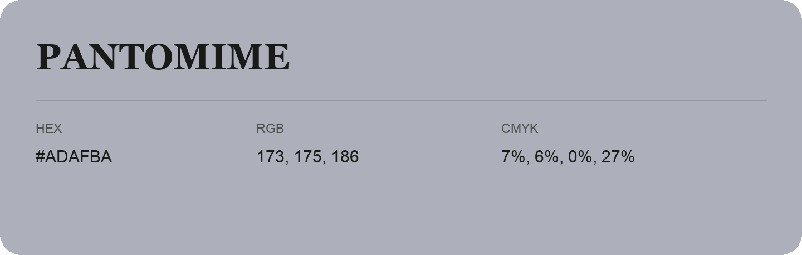

## Pantomime

- HEX: #ADAFBA
- RGB: 173, 175, 186
- CMYK: 7%, 6%, 0%, 27%
- Character: quiet, balanced, understated
- Suggested uses: professional services, minimal identities, supporting backgrounds

- Source images: iCloud Photos 2/IMG_9156.JPG
