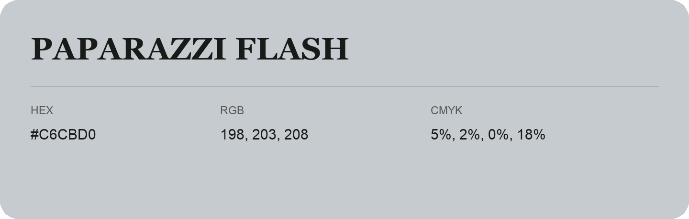

## Paparazzi Flash

- HEX: #C6CBD0
- RGB: 198, 203, 208
- CMYK: 5%, 2%, 0%, 18%
- Character: quiet, balanced, understated
- Suggested uses: professional services, minimal identities, supporting backgrounds

- Source images: iCloud Photos 2/IMG_9160.JPG
- Data provenance: RGB calculated from HEX; source text recognition was uncertain.
