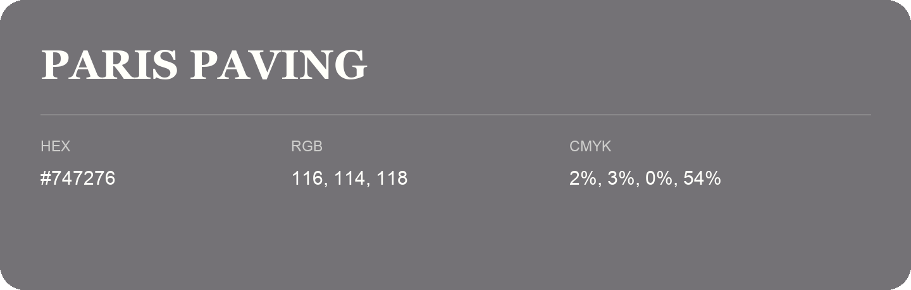

## Paris Paving

- HEX: #747276
- RGB: 116, 114, 118
- CMYK: 2%, 3%, 0%, 54%
- Character: restrained, grounded, sophisticated
- Suggested uses: premium brands, editorial typography, dark backgrounds

- Source images: IMG_9007.JPG
