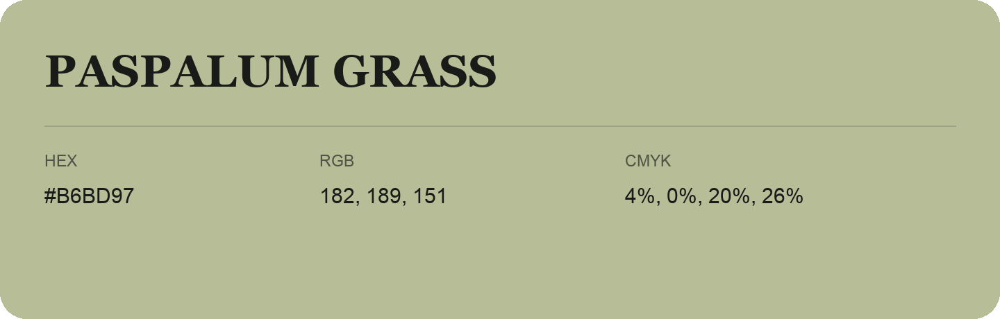

## Paspalum Grass

- HEX: #B6BD97
- RGB: 182, 189, 151
- CMYK: 4%, 0%, 20%, 26%
- Character: natural, grounded, fresh
- Suggested uses: outdoor businesses, wellness brands, organic packaging

- Source images: IMG_9070.JPG
