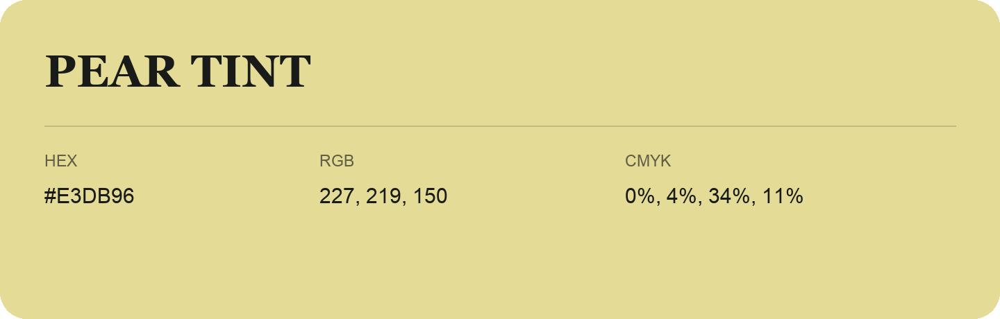

## Pear Tint

- HEX: #E3DB96
- RGB: 227, 219, 150
- CMYK: 0%, 4%, 34%, 11%
- Character: soft, gentle, approachable
- Suggested uses: friendly consumer brands, gentle backgrounds, welcoming accents

- Source images: iCloud Photos 2/IMG_9141.JPG
