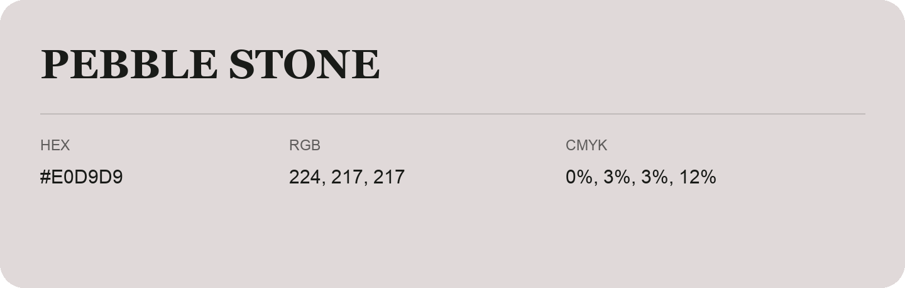

## Pebble Stone

- HEX: #E0D9D9
- RGB: 224, 217, 217
- CMYK: 0%, 3%, 3%, 12%
- Character: quiet, balanced, understated
- Suggested uses: professional services, minimal identities, supporting backgrounds

- Source images: IMG_9029.JPG
